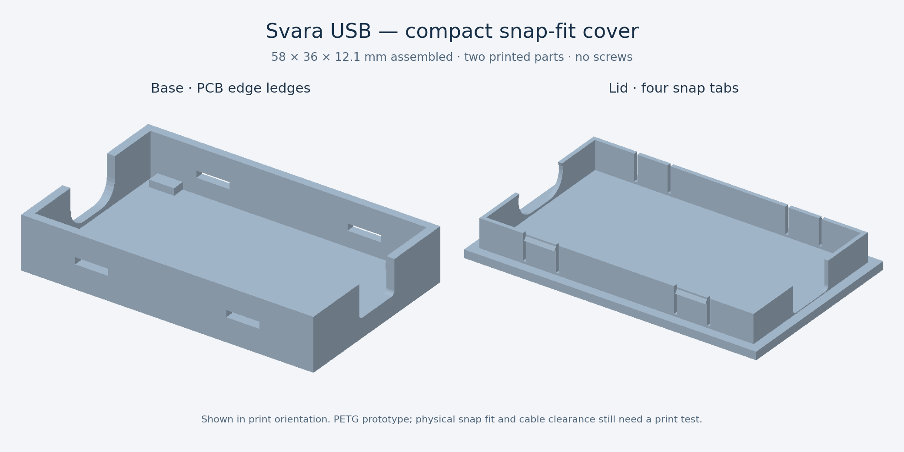

# Svara USB — revision B (prototype)

**Svara USB is a compact, USB-powered stereo digital-to-analog converter (DAC)
and headphone amplifier.** Its intended use is to turn digital audio from a
computer or another compatible USB host into an analog signal for wired
headphones or the stereo input of powered speakers.

A DAC converts the audio samples sent over USB into left and right analog
voltages. The headphone amplifier then drives the 3.5 mm output. Together, they
provide an external audio output that can be used in place of a host's built-in
headphone socket.

This repository contains the tscircuit hardware design, PCB layout, and printable
enclosure model. Audio playback requires an assembled and electrically verified
board; the development commands below open and build the hardware design.

> **Prototype status:** Revision B has documented CAD and export checks, but USB
> compatibility, audio performance, and enclosure fit still need verification on
> physical hardware. The specifications below describe the design targets, not
> measured product performance.

## What would I use it for?

| Use case | How Svara USB fits |
| --- | --- |
| Wired headphones on a computer | Provides a separate USB audio output when a headphone socket is unavailable or an external output is preferred. The target load is 32–80 Ω headphones. |
| A Raspberry Pi or another USB host board | Adds stereo analog playback to a small music player, kiosk, or embedded project with USB audio support. |
| Powered desktop speakers or a stereo amplifier | Feeds an analog stereo input from the 3.5 mm socket. This is a volume-controlled headphone output; begin at low volume and set a suitable input level. |
| Learning and hardware development | Provides a complete USB-audio design to study or adapt, including the DAC, clock, power supplies, headphone amplifier, PCB, and enclosure. |

A phone or tablet is a possible host only if it supports USB audio in host/OTG
mode and can supply the required bus power. A USB-C connector alone does not
establish compatibility; mobile-device operation has not been bench tested.

## How it works


USB also supplies the board's 5 V power. The PCM2704C uses its internal regulator
outputs, while an LP5907 provides a separate 3.3 V rail for the headphone
amplifier. The intended playback workflow uses the host's USB audio support and
volume controls, with no custom firmware upload or onboard volume buttons.

## Capabilities and limits

| Item | Design target |
| --- | --- |
| Input | USB digital audio through a USB-C receptacle and a data-capable cable |
| Audio format | Stereo, 16-bit PCM at 32, 44.1, or 48 kHz |
| Output | Unbalanced analog stereo through a 3.5 mm headphone socket |
| Headphone load | 32–80 Ω target; amplifier gain fixed at 0 dB |
| Controls | Host volume and mute; no onboard buttons |
| Power | USB bus power; configured for a 100 mA descriptor, with no USB Power Delivery negotiation |
| PCB | 54 × 32 mm, two layers, 1.6 mm FR-4 |

This design provides playback only: it has no microphone input or audio-recording
ADC. The socket's extra contact is grounded, not used for a headset microphone.
Passive loudspeakers need a separate power amplifier. High-impedance or otherwise
hard-to-drive headphones are outside the stated target. Native 24-bit,
96/192 kHz, DSD, and multichannel playback are not supported by this design.

An external DAC does not automatically improve sound quality. Noise, distortion,
usable output power, and performance relative to another audio output require
measurements on the assembled board.

## Using an assembled prototype

After completing the electrical bring-up checks in
[Manufacturing and validation](#manufacturing-and-validation):

1. Connect the USB-C port to a compatible USB host with a **data-capable** cable.
   A charge-only cable cannot carry the audio data.
2. Select the detected USB audio device as the playback output in the host's
   sound settings. Standard USB audio driver support is expected; operation on
   specific operating systems still needs physical verification.
3. Set host volume low and connect stereo headphones, or connect the output to
   the analog stereo input of powered speakers or an amplifier.
4. Play audio and increase volume gradually. Check left/right channel mapping
   and clean playback at the intended load before relying on the prototype.

## Repository guide

| File or directory | Purpose |
| --- | --- |
| [`index.circuit.tsx`](index.circuit.tsx) | Circuit connections, component placement, PCB rules, and enclosure assembly |
| [`imports/`](imports/) | Component definitions, footprints, supplier identifiers, and CAD model links |
| [`enclosure.tsx`](enclosure.tsx) | Two-piece snap-fit cover, PCB ledges, latch geometry, and port openings |
| [`export-enclosure.mjs`](export-enclosure.mjs) | Exports the enclosure base and lid as printable STLs |
| [`package.json`](package.json) | Development, type-checking, build, and enclosure-export commands |
| `dist/` | Generated circuit and enclosure artifacts; ignored by Git |

## Design assumptions

- Stereo USB Audio, 16-bit, 32/44.1/48 kHz. Host volume and mute; no onboard buttons.
- 32–80 Ω headphones. Amplifier gain is 0 dB (G0 high, G1 low). The nominal DAC
  level is approximately 0.65 Vrms: about 13 mW/channel into 32 Ω and 5 mW into
  80 Ω before losses. These are calculations, not guaranteed or measured ratings.
- USB bus powered, 100 mA descriptor (PSEL high, HOST low). No USB PD negotiation.
  Each CC pin has its own 5.1 kΩ pull-down. Both connector orientations are wired.
- PCM2704C VDD/VCCP/VCCL/VCCR are separate internal regulator outputs, each with
  1 µF decoupling. They do not power the headphone amplifier. VCOM has 10 µF.
- LP5907 supplies 3.3 V only to the amplifier. USB suspend drives amplifier EN low;
  the LDO stays enabled. Input capacitance and suspend current need bench checks.
- 12 MHz, 20 pF crystal; pins 1/3 are the resonator, pins 2/4 are grounded case pads.
  Two 33 pF loads assume about 3.5 pF effective stray capacitance. Verify frequency,
  startup and drive level on the prototype; the imported 22 pF alternatives remain.
- DAC outputs use 22 Ω/22 nF RF filters and AC coupling into the amplifier's
  inverting inputs. Non-inverting inputs are grounded, following TI Figure 27.
  At 0 dB, 1 µF and 19.8 kΩ give a nominal 8 Hz high-pass corner. Both channels invert.
- HPVDD has only its 2.2 µF bypass; it must never be tied to the external 3.3 V rail.
  The charge pump has a 1 µF flying capacitor and 1 µF HPVSS reservoir. Outputs are
  ground referenced and connect directly to the socket without output capacitors.
- PJ-320D is a four-contact socket: imported pin 2 = tip/left, 3 = first ring/right,
  4 = second ring, 1 = sleeve. Pins 1 and 4 are grounded for stereo headphones;
  there is no microphone input. Confirm the purchased socket with a continuity test.
- Compact board: 54 × 32 mm, 2-layer FR-4, 1.6 mm (revision A: 60 × 34 mm; 15.3% less area). USB-C and
  headphone socket face opposite ends. Four optional mounting holes are retained;
  the snap-fit cover below holds the PCB by its edges without screws.

The 23 original imported models, their copper geometry and supplier identifiers
are retained. One 22 nF type (C21122) was added for the output filters. Connector
primitive types and power/NC pin attributes were corrected without changing pads.
Legend strokes and labels were adjusted to 0.15 mm ink and at least 1 mm character
height; a few outline stubs were trimmed to preserve pad clearance.
Unused imported LED, buttons and passive alternatives are not populated.

## Local workflow

Install [Bun](https://bun.sh/) and use the project-local CLI from the repository
root. The project pins tscircuit to version `0.0.3033`; dependency installation
uses the committed lockfile.

```sh
bun install --frozen-lockfile
bun run typecheck
bun run build --disable-parts-engine --svgs
bun run dev
```

The development viewer lets you inspect the schematic, PCB, and 3D assembly.
After building, export fabrication or assembly-viewing artifacts with:

```sh
./node_modules/.bin/tsci export dist/index/circuit.json --format gerbers --output "$PWD/dist/svara-usb-gerbers.zip"
./node_modules/.bin/tsci export dist/index/circuit.json --format glb --output "$PWD/dist/enclosure/svara-usb-assembly.glb"
```

Generated output and caches stay ignored. The parts-engine option avoids an
unavailable remote datasheet/availability service; it does not validate stock.
PCM2704C JLCPCB assembly availability remains unconfirmed.

## Enclosure prototype

The enclosure is a small protective cover: **one shallow base and one snap-on
lid**. Four ledges support the PCB edges, and the lid skirt holds the board down.
There are no screw bosses, mounting screws, support frame, or separate carrier.
The PCB and its electrical design are unchanged.



| Feature | Nominal dimension |
| --- | --- |
| Assembled outside | **58 × 36 × 12.1 mm** |
| Height reduction | About **33%** from the previous 18.1 mm enclosure |
| Walls, floor, and lid plate | 1.6 mm |
| PCB edge clearance | 0.4 mm per side |
| Gap below the PCB | 1.4 mm above the inside floor |
| Space above PCB top | 5.9 mm; about 0.6 mm above the tallest supplied component model |
| Lid skirt | 0.8 mm thick, with 0.2 mm clearance per side to the base |
| Snap retention | Four flexible tongues with ramped hooks and 0.3 mm nominal engagement |

`enclosure.tsx` defines both parts with the pinned tscircuit printed-part/JSCAD
API. The preview and STL exporter use the same geometry; the exporter only turns
the lid over and places each part on the print bed.

The USB-C and headphone openings are at opposite ends. The base openings run up
to the lid seam, so the base has no thin bridges above the ports. The lid skirt
has a 12.6 × 7.6 mm USB opening and a 10 × 6.5 mm headphone opening with 0.8 mm
corner radii. Their positions follow the current connector models. Check the
actual purchased connectors and intended plugs, especially bulky overmoulds or
right-angle cables. Moving either connector requires updating these openings.

Print **PETG** as a starting material on a calibrated 0.4 mm nozzle FDM printer.
The 0.8 mm tongues allow two nominal nozzle widths; layer settings and actual
extrusion width still need tuning. Print the base floor down and the lid outer
face down, with its skirt facing up. Both STL files are placed at Z=0. The small
latch windows require short bridges; inspect them in the slicer before printing.

To assemble, rest the PCB on the four ledges, align the port openings, and press
the lid down until the hooks engage. The skirt leaves 0.25 mm nominal vertical
play above the PCB. To reopen it, release the hooks through the side windows
with a thin plastic tool and gently lift the lid around the perimeter. The
retained 2.2 mm PCB mounting holes are optional and unused by this cover.

Snap force, retention, fatigue life, printer tolerances, solder-tail clearance,
and cable fit need a physical prototype. Adjust the sliding clearance or hook
engagement if needed; do not force a tight print onto the PCB. This is a
protective prototype cover, not a sealed or mechanically qualified product.

Generate the board and the two printable parts with:

```sh
bun run export:enclosure
# dist/enclosure/svara-usb-base.stl
# dist/enclosure/svara-usb-lid.stl
```

Revision A is package v1.0.0. The compact PCB remains revision B, introduced in
v1.1.0. Package v1.1.1 replaces its tall friction-fit enclosure with this snap-fit
cover.

## Manufacturing and validation

This revision targets ordinary single-design 2-layer fabrication, 1 oz copper,
green mask, through vias with nominal 0.30 mm drill/0.60 mm pad, and no filled,
capped, blind or buried vias. A nominal drill is not a guaranteed finished bore.
The USB-C shell retains its original plated slots and locating holes.

JLCPCB's current surcharge rules identify small holes below 0.30 mm and drilling
density above 150,000 holes/m² as potential extra charges. Inspect the **exported**
Gerber and Excellon files, including slots, before ordering. Finish, assembly,
extended-part feeder fees, stock, stencil, shipping, taxes and the final quotation
are separate from a geometry check. Fine-pitch assembly may favor ENIG, which is
a priced finish option. No zero-surcharge quotation has been obtained.

The revision-B export was checked as actual Gerber/Excellon geometry:

- **54 × 32 mm**, two copper layers; 49 through vias at **0.30/0.60 mm**.
- Four 0.8 mm plated USB slots; four connector locating holes (0.6/1.0 mm) and
  four 2.2 mm mounting holes. There are 61 physical hole features. Conservatively
  counting slot starts and routes separately gives **65 operations, 37,616/m²**,
  below the published 150,000/m² drilling-density surcharge threshold.
- Minimum trace width: 0.15 mm. Minimum disconnected-copper gap: approximately
  0.15 mm. Copper-to-routed-edge clearance: at least 0.2258 mm on both layers.
  NPTH copper clearance exceeds 0.296 mm; minimum hole-edge spacing is 0.4545 mm.
- Via rings are 0.15 mm. Retained USB slot rings are approximately 0.1999 mm,
  above JLCPCB's 0.18 mm absolute minimum for 1 oz two-layer component holes and
  below its 0.25 mm recommendation. Original imported copper/hole declarations
  remain unchanged. The mounting keepouts are nominally 2.7 mm radius; use
  M2 screw heads no larger than 4 mm.
- Slot routing density is conservatively 8.37 m/m², below the published narrow-slot
  routing threshold of 80 m/m². Combined exposed copper is about 7.20% of board
  area; this does not make ENIG a free finish option.
- All **31 net groups** connect in exported copper with no opens or net-to-net
  shorts, and the source netlist matches revision A. The crystal branches remain
  on the top layer with no clock vias. All via bores clear top pad mask openings.
  Legend has 0.15 mm strokes, at least 1 mm characters, no exposed-pad overlap,
  and at least 0.153 mm pad-opening clearance.

These checks avoid the documented small-via and drilling-density fee triggers;
they do not establish a zero-surcharge quotation or production readiness.

Typecheck, the local circuit build, and `bun run export:enclosure` pass with no
CAD errors. The CLI emits styling/metadata warnings for the custom schematic
sheet and the passive ferrite modeled as a chip. Its route-cache warning concerns
the manually authored clock net; it does not prevent routing or exports.

The assembly contains the PCB, all 37 populated component instances, and the
snap-fit base and lid. The two exported STL parts are each one watertight solid
with consistent winding and positive volume. CAD intersections show no overlap
between the closed case parts, the PCB envelope, or any of the 37 supplied
component model envelopes. The tallest model is approximately 5.3 mm above the
PCB top, leaving 0.6 mm to the lid. These are model checks, not a physical fit,
snap-retention, or print test.

The BOM/CPL audit matches all 37 unique designators, MPNs and 19 supplier IDs to
the CAD source. Placement centers match within 0.0005 mm; layers and raw PCB
angles match exactly. All 37 parts lack JLCPCB reference-orientation metadata,
so supplier zero-degree orientations remain unverified. J1's exported derived
center is X = -23.525 mm while its footprint anchor is X = -23.100 mm; confirm
its pickup datum in the assembly preview. The placement file is **not released
for turnkey assembly**. Exact-part stock and extended-part setup fees remain
unconfirmed; no JLCPCB order or assembly upload has been placed.

Before production, physically verify USB enumeration in both cable orientations,
active/suspend current and inrush, all rails, crystal startup/frequency, output
DC, channel mapping, clipping/THD under load, thermal behavior, ESD, and enclosure
fit with the intended cables, plastic and printer. Check solder tails against
the 1.4 mm underside gap and test the snap tabs before repeated assembly.
USB pair impedance and return paths require review against the chosen stackup;
no controlled-impedance, USB certification or measured audio claim is made.

## Primary references

- [TI PCM2704C, SBFS036B](https://www.ti.com/lit/ds/symlink/pcm2704c.pdf): pins,
  bus-powered configuration, clock, USB and decoupling; sections 9–12.
- [TI TPA6132A2, SLOS597B](https://www.ti.com/lit/ds/symlink/tpa6132a2.pdf): gain
  table, single-ended Figure 27, charge pump, decoupling and layout; sections 7–10.
- [TI LP5907](https://www.ti.com/lit/ds/symlink/lp5907.pdf).
- [ST USBLC6-2](https://www.st.com/resource/en/datasheet/usblc6-2.pdf).
- [SHOU HAN PJ-320D manufacturer drawing, C431535](https://datasheet.lcsc.com/datasheet/pdf/50aca6c1750ca25d6422baa81dc852bf.pdf?productCode=C431535),
  [numbered contact drawing](https://static.chipdip.ru/lib/521/DOC042521444.pdf).
- [YXC X322512MSB4SI manufacturer datasheet](https://www.micros.com.pl/mediaserver/Q12.000_3.2x2.5_Y_0001.pdf).
- [JLCPCB capabilities](https://jlcpcb.com/capabilities/pcb-capabilities/),
  [surcharge rules](https://jlcpcb.com/help/article/in-what-cases-will-there-be-charged-extra).

- [Printed-part API](https://docs.tscircuit.com/elements/assembly-printedpart).
  The snap-fit cover uses the project's pinned tscircuit printed-part and JSCAD
  APIs rather than a separate model edited only at export time.
